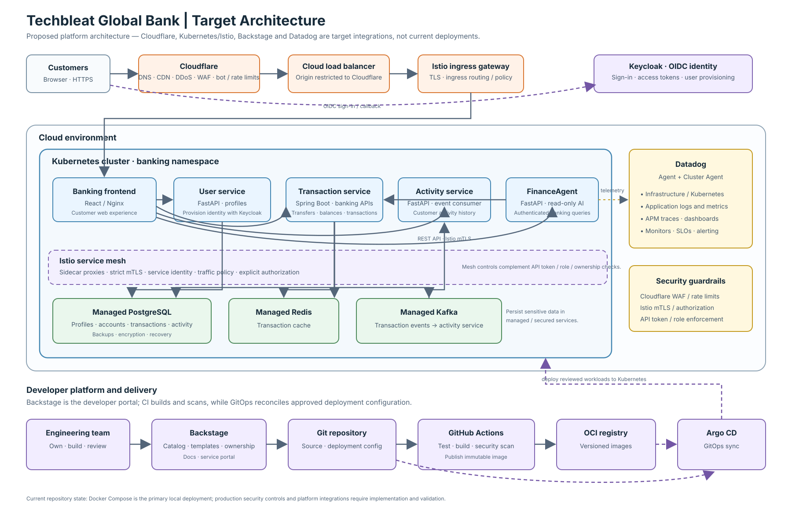

# Target Architecture

This diagram shows a target deployment for Techbleat Global Bank. The current
application runs primarily with Docker Compose; Cloudflare, Backstage, Istio,
Datadog, and the GitOps delivery flow below are proposed integrations, not
claims about components already deployed.

```mermaid
flowchart LR
    customer["Customers"]

    subgraph edge["Edge security"]
        cf["Cloudflare<br/>DNS · CDN · DDoS protection<br/>WAF · bot controls · rate limits"]
    end

    subgraph delivery["Developer platform and delivery"]
        engineer["Engineering team"]
        backstage["Backstage<br/>Service catalog · templates<br/>ownership · documentation"]
        git["Git repository<br/>Application code · Kubernetes config"]
        actions["GitHub Actions<br/>Tests · build · image and dependency scans"]
        registry["Container registry<br/>Versioned OCI images"]
        argocd["Argo CD<br/>GitOps reconciliation"]
        engineer --> backstage
        backstage -. "scaffolds services / links workflows" .-> git
        engineer --> git
        git --> actions
        actions -->|"publish immutable image"| registry
        git -->|"reviewed deployment config"| argocd
        registry -. "image reference" .-> argocd
    end

    subgraph cloud["Cloud environment"]
        lb["Public cloud load balancer"]

        subgraph cluster["Kubernetes cluster · banking namespace"]
            ingress["Istio ingress gateway"]
            frontend["Banking frontend<br/>React / Nginx"]
            userSvc["User service<br/>FastAPI"]
            transactionSvc["Transaction service<br/>Spring Boot"]
            activitySvc["Activity service<br/>FastAPI"]
            financeAgent["FinanceAgent<br/>FastAPI"]
            mesh["Istio service mesh<br/>Sidecar proxies · mTLS<br/>traffic policy · authorization"]
            k8sAgent["Datadog Agent / Cluster Agent<br/>infrastructure and application telemetry"]

            ingress --> frontend
            frontend -->|"mTLS · REST"| userSvc
            frontend -->|"mTLS · REST"| transactionSvc
            frontend -->|"mTLS · REST"| activitySvc
            frontend -->|"mTLS · REST"| financeAgent
            financeAgent -->|"mTLS · read-only banking calls"| transactionSvc
            transactionSvc -->|"publish events"| kafka
            kafka -->|"consume activity events"| activitySvc
            transactionSvc -->|"cache"| redis
            userSvc -->|"profile / account data"| postgres
            transactionSvc -->|"transaction data"| postgres
            activitySvc -->|"activity history"| postgres
            userSvc -->|"admin API · user provisioning"| keycloak

            mesh -. "sidecars protect service-to-service traffic" .- frontend
            mesh -. "sidecars protect service-to-service traffic" .- userSvc
            mesh -. "sidecars protect service-to-service traffic" .- transactionSvc
            mesh -. "sidecars protect service-to-service traffic" .- activitySvc
            mesh -. "sidecars protect service-to-service traffic" .- financeAgent
        end

        subgraph data["Managed data services"]
            postgres[("PostgreSQL<br/>Persistent banking data")]
            redis[("Redis<br/>Cache")]
            kafka[("Kafka<br/>Banking activity events")]
        end

        keycloak["Keycloak<br/>OIDC identity provider"]
    end

    subgraph observability["Observability"]
        datadog["Datadog SaaS<br/>APM · logs · metrics · traces<br/>dashboards · monitors · SLOs"]
    end

    customer -->|"HTTPS"| cf
    cf -->|"WAF-inspected HTTPS"| lb
    lb --> ingress
    customer <-->|"OIDC sign-in / callback"| keycloak
    frontend -. "validate identity token" .-> keycloak
    argocd -->|"sync desired state"| ingress
    argocd -->|"deploy workloads"| frontend
    argocd -->|"deploy workloads"| userSvc
    argocd -->|"deploy workloads"| transactionSvc
    argocd -->|"deploy workloads"| activitySvc
    argocd -->|"deploy workloads"| financeAgent
    k8sAgent -. "cluster, node, container, APM, logs and traces" .-> datadog
    frontend -. "instrumented telemetry" .-> k8sAgent
    userSvc -. "instrumented telemetry" .-> k8sAgent
    transactionSvc -. "instrumented telemetry" .-> k8sAgent
    activitySvc -. "instrumented telemetry" .-> k8sAgent
    financeAgent -. "instrumented telemetry" .-> k8sAgent

    classDef security fill:#fff0e6,stroke:#d55e00,color:#222
    classDef platform fill:#eee8ff,stroke:#7253a3,color:#222
    classDef workload fill:#e8f4ff,stroke:#2878a8,color:#222
    classDef data fill:#e8f7ed,stroke:#39804c,color:#222
    classDef observe fill:#fff8d8,stroke:#ae8b00,color:#222
    class cf,lb,ingress,mesh,keycloak security
    class engineer,backstage,git,actions,registry,argocd platform
    class frontend,userSvc,transactionSvc,activitySvc,financeAgent workload
    class postgres,redis,kafka data
    class k8sAgent,datadog observe
```

## Request and identity flow

1. Customer HTTPS traffic passes through Cloudflare's DNS, DDoS protection,
   WAF, bot controls, and rate limits before reaching the cloud load balancer
   and Istio ingress gateway.
2. The gateway routes requests to the frontend. The browser signs in with
   Keycloak using OIDC; the frontend sends the resulting access token with
   API requests.
3. Istio secures and governs in-cluster service traffic. Each API must also
   validate token signature, issuer, audience, roles, and account ownership
   before it handles protected banking operations.
4. The services use PostgreSQL for persistent data, Redis for caching, and
   Kafka for transaction/activity events. Production deployments should use
   managed data services or appropriately operated stateful services with
   backups, encryption, and recovery procedures.

## Delivery and operations

- Backstage provides the developer portal, service catalog, ownership metadata,
  and templates. It integrates with CI/CD tools; it is not itself the build
  system or Kubernetes reconciler.
- GitHub Actions tests, builds, and scans versioned container images, then
  publishes them to a registry. Changes to deployment configuration are
  reviewed in Git and reconciled by Argo CD.
- Datadog Agents collect cluster, node, and container signals. Application
  instrumentation and log forwarding provide service-level traces, metrics,
  and logs for dashboards, monitors, and SLOs.

## Security implementation notes

- Enforce Cloudflare WAF and rate-limit policies at the edge, and keep origin
  services inaccessible directly from the public internet.
- Configure Istio mTLS in strict mode where supported, plus explicit
  authorization policies and ingress restrictions. Mesh policy complements
  application-level authorization; it does not replace it.
- Store credentials in a managed secret store and deliver them to workloads
  securely. Do not put secrets in Git, container images, or Backstage
  templates.
- The repository's security notes identify missing bearer-token validation
  and server-side role enforcement in banking APIs. Implement and test those
  controls before exposing real customer data or transactions.
- The current Compose deployment runs PostgreSQL, Redis, and Kafka alongside
  the services. In Kubernetes, these can be provisioned as managed services;
  local Compose remains useful for development.
